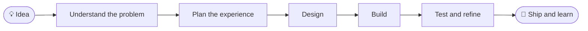

<!-- Replace YOUR_GITHUB_USERNAME with your GitHub username. -->

 

  

---

## About

I'm a design-minded developer and product builder who enjoys taking an idea from an early sketch to a working digital experience. I'm interested in the complete product journey: understanding a problem, planning the user experience, designing the interface, building features, and improving the result through iteration.

I enjoy experimenting with web and mobile technologies, exploring SaaS opportunities, and creating products that make complicated workflows feel simpler.

- Building and exploring web applications, mobile apps, and SaaS products.
- Interested in thoughtful UI/UX, clean interfaces, and intuitive user journeys.
- Enjoy turning real-world problems into practical product features.
- Learning continuously by designing, coding, testing, and shipping.

## What I'm interested in

| Area | Focus |
|:--|:--|
| Product development | Turning ideas and user problems into useful products |
| Frontend development | Responsive interfaces and reusable components |
| UI/UX | Clear layouts, accessible flows, and meaningful details |
| Full-stack exploration | Connecting interfaces, data, and application workflows |
| SaaS & startups | B2B tools, marketplaces, and product thinking |

## Tech stack & tools

**Languages and frontend**

**Data, mobile and tools**

> Technologies shown reflect tools explored or used across projects; this is not a claim of expert-level proficiency in every tool.

---

## Selected projects

### 01 — B2B Import & Export Trade Platform
**A SaaS marketplace concept for buyers, suppliers, importers, and exporters.**

The goal is to make B2B trade discovery and sourcing workflows more organized by bringing product listings and requests for quotation (RFQs) into one experience.

- Product listing flows for buyers and suppliers.
- RFQ creation for sharing sourcing requirements and receiving quotations.
- Workflows designed around importer, exporter, buyer, and supplier roles.
- Exploring supplier discovery and smarter sourcing experiences.

`SaaS` `B2B Marketplace` `Product Listings` `RFQ Workflows`

<!-- Add your actual repository and demo URLs. -->
[Repository](YOUR_TRADE_PLATFORM_REPO_URL) · [Live demo](YOUR_TRADE_PLATFORM_DEMO_URL)

### 02 — Tasbih Counter App
**A simple, focused digital companion for daily Dhikr.**

A mobile app direction centered on a calm counting experience and practical tools for keeping track of personal Dhikr routines.

- Tap-to-count interaction and counting targets.
- Dhikr options, with room for custom entries and favourites.
- Exploring history, statistics, and streak tracking.
- Focus on responsive interactions and a distraction-free interface.

`Mobile App` `React Native / Expo exploration` `Product Design`

[Repository](YOUR_TASBIH_REPO_URL) · [Live demo](YOUR_TASBIH_DEMO_URL)

### 03 — Mental Wellness Companion
**A concept for a more approachable space for reflection and emotional well-being.**

An idea shaped around everyday challenges people may face with relationships, family, studies, career, stress, anxiety, and regret. The product direction emphasizes a supportive, private, and approachable experience.

- Journaling and personal reflection.
- Mood check-ins and noticing patterns over time.
- Guided grounding and calming exercises.
- Safety-conscious support features.

`Product Concept` `Wellness` `UX Research`

### 04 — Personal Portfolio
**A place to present projects, experiments, and the work behind them.**

A portfolio website concept focused on clear storytelling, modern visual design, and making it easy to explore projects and skills.

`Portfolio` `Web Design` `Frontend`

---

## How I approach building

## GitHub activity

 

 

---

## Currently exploring

- Building and refining SaaS product experiences.
- Improving frontend architecture and TypeScript workflows.
- Designing clearer user journeys and polished interfaces.
- Turning early-stage ideas into usable prototypes.
- Exploring how thoughtful design and technology can solve practical problems.

## Let's connect

  

  

*Thanks for stopping by. Explore the repositories and follow the build journey.*

